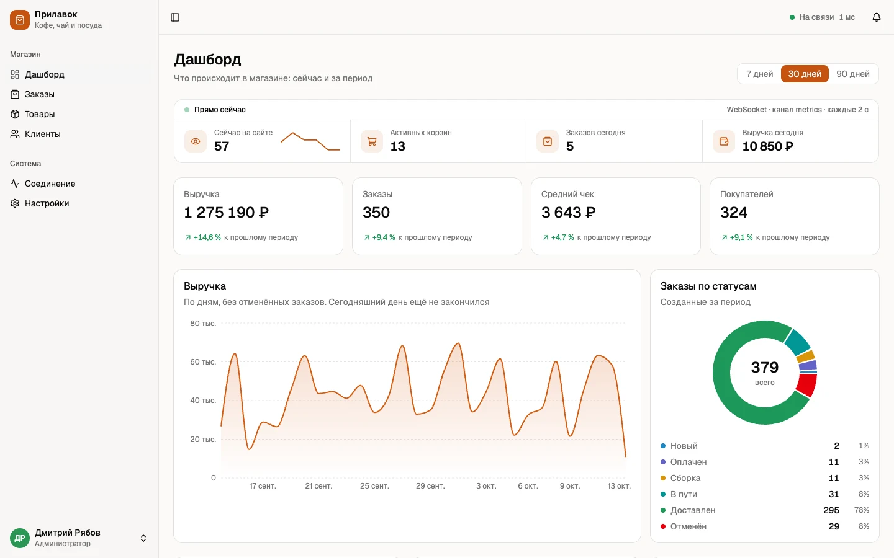
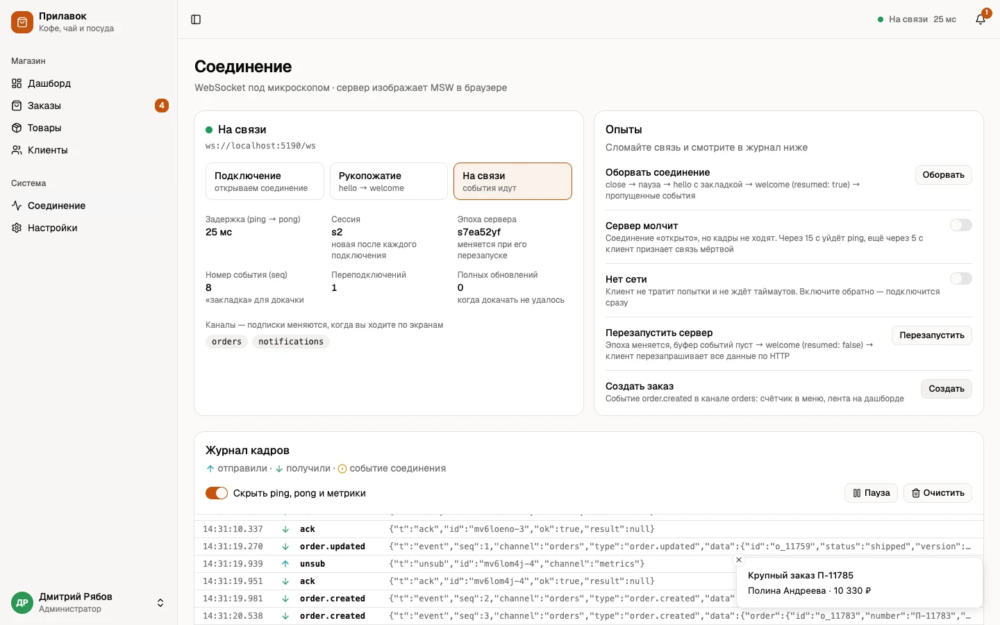
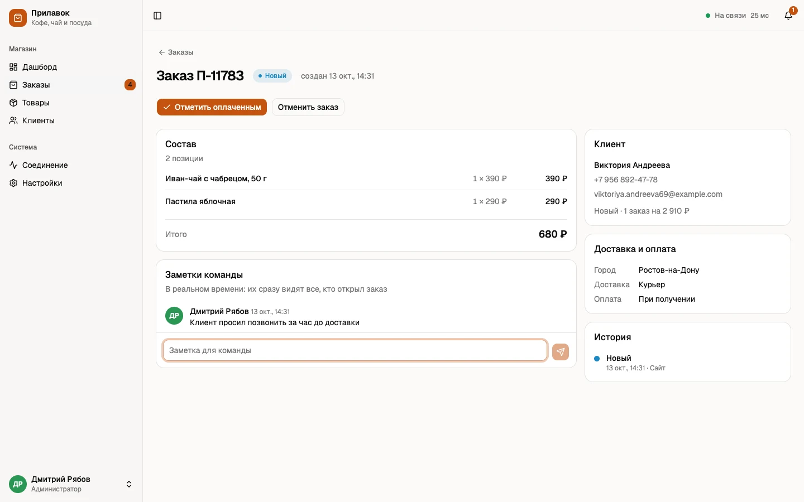
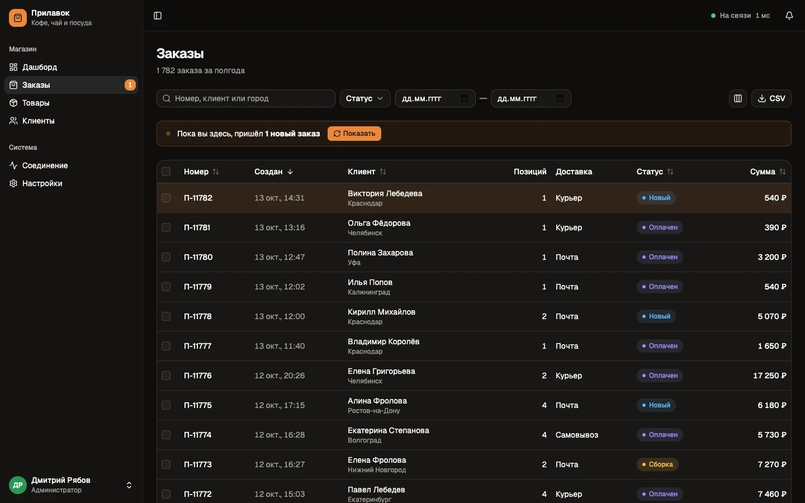
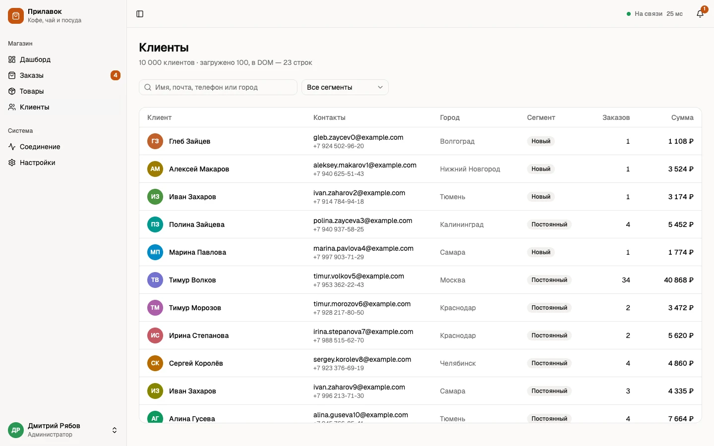

# Прилавок — админка интернет-магазина

Админка магазина кофе, чая и посуды: дашборд, заказы, товары, клиенты, роли. Главная тема —
**реальное время по WebSocket**, сделанное так, как это делают в продукте: переподключение,
проверка связи, докачка пропущенных событий, подтверждения, синхронизация с кэшем запросов.

**Демо:** https://dmitriy9427.github.io/prilavok/ · **Учебник:** [docs/](docs/README.md)

Бэкенда у демо нет: сервер изображает код в браузере (MSW), заказы «приходят» сами. Тот же
серверный код запускается и по-настоящему — на Node.js.



| Соединение: журнал кадров и «сломать связь» | Заказ: статус, заметки, присутствие |
| --- | --- |
|  |  |

| Заказы (тёмная тема) | Клиенты: 10 000 строк |
| --- | --- |
|  |  |

## WebSocket

Свой клиент в два слоя, без библиотек:

- **Транспорт** ([socket.ts](src/realtime/socket.ts)) — переподключение с нарастающей паузой и
  случайным разбросом, таймаут подключения, реакция на `online` / `offline` и возврат на вкладку.
- **Протокол** ([client.ts](src/realtime/client.ts)) — рукопожатие с токеном, каналы со
  счётчиком слушателей, heartbeat (ping/pong и задержка), запросы с подтверждением и
  таймаутом, очередь на время обрыва, повтор идемпотентных запросов.
- **Докачка** — сервер нумерует события и хранит последние 500; после обрыва клиент называет
  номер последнего полученного и получает пропущенное. Сервер перезапускался («эпоха»
  сменилась) — клиент перезапрашивает данные по HTTP.
- **События → кэш** ([sync.ts](src/realtime/sync.ts)) — событие правит кэш TanStack Query;
  версии записей защищают от двойного применения и от событий не по порядку.
- **Сервер** ([hub.ts](src/backend/hub.ts)) не знает про сеть: один и тот же код работает в
  браузере через MSW и в Node с библиотекой `ws` ([server/index.ts](server/index.ts)).
- **Экран «Соединение»** — состояние, каналы, журнал кадров и кнопки «оборвать», «сервер
  молчит», «нет сети», «перезапустить сервер»: видно по кадрам, как клиент восстанавливается.

Что идёт по сокету: лента новых заказов, смена статусов, живые метрики, остатки товаров,
уведомления, заметки к заказу и «кто сейчас смотрит этот заказ».

## Остальное

- **Заказы** — серверная таблица (TanStack Table v9): фильтры, сортировка и страница живут
  в адресе; массовые действия; экспорт в CSV.
- **Карточка заказа** — оптимистичная смена статуса с откатом, защита от конфликта версий (409).
- **Товары** — форма на react-hook-form + zod; одна схема проверяет и в браузере, и на сервере.
- **Клиенты** — 10 000 строк: бесконечная подгрузка + виртуализация (в DOM ~20 строк).
- **Роли** — администратор, менеджер, наблюдатель; права проверяются в интерфейсе и на сервере.
- Светлая и тёмная тема, адаптив, доступность, 138 тестов.

## Запуск

```bash
npm install
npm run dev
```

С настоящим сервером (в двух терминалах) — можно открыть два окна под разными ролями и
смотреть кадры в DevTools → Network → WS:

```bash
npm run server
```

```bash
npm run dev:real
```

| Команда | Что делает |
| --- | --- |
| `npm run dev` | интерфейс + сервер-мок в браузере |
| `npm run server` | сервер на Node: HTTP + WebSocket, порт 8787 |
| `npm run dev:real` | интерфейс, подключённый к этому серверу |
| `npm test` | 138 тестов |
| `npm run check` | линтер + типы + тесты + сборка |

## Стек

React 19 · TypeScript · Vite · TanStack Router / Query / Table / Virtual · Tailwind 4 ·
shadcn/ui · react-hook-form · zod · Recharts · MSW · `ws` · Vitest

## Структура

```
src/
├── shared/      типы, протокол WebSocket, схемы, права — общее для клиента и сервера
├── realtime/    клиент реального времени: транспорт, протокол, хуки, синхронизация с кэшем
├── backend/     «сервер»: хаб, REST, база в памяти, симулятор (работает в браузере и в Node)
├── mocks/       переходник MSW
├── api/         HTTP-клиент, запросы и мутации
├── routes/      экраны (файл = адрес)
├── features/    части экранов
└── components/  общие компоненты; ui/ — shadcn
server/          настоящий сервер на Node
docs/            учебник: 12 глав, лабораторные, разбор багов, вопросы к собеседованию
```

## Учебник

[С чего начать](docs/README.md) · [WebSocket с нуля](docs/02-websocket-basics.md) ·
[Протокол](docs/03-protocol.md) · [Переподключение и heartbeat](docs/04-reconnect.md) ·
[Докачка и идемпотентность](docs/05-resume.md) · [Лабораторные](docs/labs.md) ·
[Найденные баги](docs/lessons.md) · [Вопросы к собеседованию](docs/interview.md)
