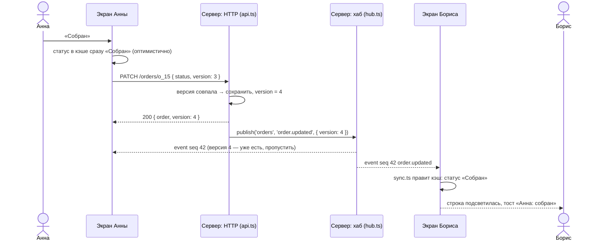

# 00. С чего начать

Этот учебник для человека, который знает React (компоненты, `useState`, `useEffect`) и делал
запросы через `fetch`, но ещё не писал приложений «в реальном времени» и не работал с
WebSocket, TanStack Query и TanStack Router.

## Как устроена каждая глава

1. **Зачем** — какую боль решает эта часть, на бытовом примере.
2. **Как это выглядит** — схема разговора клиента и сервера или маленький пример.
3. **Как это сделано в «Прилавке»** — настоящий код с разбором.
4. **Ошибки** — что ломается у всех в первый раз.
5. **Попробуйте сами** — задания с ответами под спойлером.

Читайте с запущенным проектом: `npm run dev`, рядом — код и экран **«Соединение»** (в меню
слева). На нём видно каждый кадр, который ходит по сокету.

## Картинка целиком: как изменение доходит до чужого экрана

Два менеджера, Анна и Борис, открыли один и тот же заказ. Анна нажимает «Собран». Что
происходит:

Обратите внимание на три вещи — на них построен весь проект:

1. **Изменение идёт по HTTP, а новость о нём — по WebSocket.** HTTP хорош для «сделай и скажи,
   получилось ли» (коды ответа, повторы, кэш). Сокет — для «сообщи всем, что случилось».
2. **Экраны читают данные только из кэша запросов.** Ни таблица, ни карточка заказа не знают,
   что такое сокет: событие правит кэш (`sync.ts`), а React перерисовывает всё, что из этого
   кэша читает. Глава 07.
3. **Номера.** У события есть сквозной номер `seq` (чтобы после обрыва дослать пропущенное —
   глава 05), у заказа — версия `version` (чтобы не применить одно изменение дважды и не
   затереть новое старым — глава 07).

## Словарь в одну строку

Вернитесь сюда, если встретили незнакомое слово.

| Слово | Простыми словами | Пример в проекте |
| --- | --- | --- |
| **WebSocket** | Постоянное соединение, по которому **обе** стороны шлют сообщения, когда захотят | `new WebSocket('ws://localhost:8787/ws')` |
| **Кадр (frame)** | Одно сообщение в сокете. У нас — JSON с полем `t` | `{ "t": "ping", "ts": 1791888736761 }` |
| **Протокол** | Договорённость, что значит каждый кадр | `src/shared/protocol.ts` |
| **Рукопожатие** | Первый обмен: «кто я» → «принято» | `hello` → `welcome` |
| **Канал** | Тема, на которую подписываются | `orders`, `order:o_15` |
| **Подписка** | «Присылай мне события этого канала» | `sub` / `unsub`, `useChannel(...)` |
| **Событие-факт** | «Что-то случилось» — терять нельзя, есть номер | `order.created`, `note.added` |
| **Событие-состояние** | «Сейчас так» — старое никому не нужно, номера нет | `metrics.tick`, `presence` |
| **seq** | Сквозной номер факта на сервере | `event { seq: 42 }` |
| **Закладка** | Номер последнего полученного события — «на чём я остановился» | `snapshot.seq` в клиенте |
| **Эпоха** | Id запуска сервера: после перезапуска нумерация начинается заново | `hub.epoch` |
| **Докачка (resume)** | После обрыва назвать закладку и получить пропущенное | `hello { resume: { epoch, seq } }` |
| **Ресинк (resync)** | Пропущенное не дослать — перезапросить всё по HTTP | `onResync()` |
| **Heartbeat** | Регулярное «ты жив?» — «жив», чтобы заметить молча умершую связь | `ping` / `pong` раз в 15 с |
| **Backoff** | Пауза перед повтором, растущая с каждой неудачей | 0,5 с → 1 с → 2 с … 30 с |
| **Jitter** | Случайный разброс паузы, чтобы клиенты не вернулись все разом | `ceiling / 2 + random() * ceiling / 2` |
| **ack** | Ответ сервера на конкретный запрос (по `id`) | `req { id: r1 }` → `ack { id: r1, ok: true }` |
| **Идемпотентность** | Повтор запроса не создаёт второй результат | заметка с `clientId` |
| **Хаб** | Серверная часть сокета: сессии, подписки, рассылка | `src/backend/hub.ts` |
| **MSW** | Подделка сервера внутри браузера | `src/mocks/browser.ts` |
| **Кэш запросов** | Сохранённые ответы сервера; из него читают экраны | TanStack Query, `queryClient` |
| **Ключ запроса** | Адрес данных в кэше | `['orders', 'detail', 'o_15']` |
| **Инвалидация** | «Эти данные устарели — перезапроси, если они на экране» | `invalidateQueries({ queryKey: keys.stats })` |
| **Оптимистичное обновление** | Показать результат сразу, а при отказе сервера — откатить | смена статуса, заметки |
| **Версия записи** | Счётчик изменений заказа; защита от гонок | `order.version` |
| **Присутствие** | «Кто ещё сейчас смотрит этот заказ» | аватары на странице заказа |

## Как читать код проекта

- **Комментарий в начале каждого файла** объясняет «зачем» и «почему так». Начинайте с него.
- **Тест рядом** (`*.test.ts`) читается как список требований: «после обрыва досылает
  пропущенное», «не переподключается после 4401».
- **Не нашли, где что-то делается?** Ищите по тексту на экране или в журнале кадров:
  «Нет pong — считаем соединение мёртвым» → `src/realtime/client.ts`.

## Порядок чтения

| Если вы хотите… | Читайте |
| --- | --- |
| запустить и осмотреться | [01. Обзор и запуск](01-overview.md) |
| понять WebSocket с нуля | [02](02-websocket-basics.md) → [03](03-protocol.md) → [04](04-reconnect.md) → [05](05-resume.md) |
| понять сервер | [06. Сервер](06-server.md) |
| связать сокет с интерфейсом | [07. Сокет и интерфейс](07-cache-sync.md) |
| перестать писать `fetch` в `useEffect` | [08. TanStack Query](08-data.md) |
| маршруты, таблицы, формы, интерфейс | [09](09-routing.md), [10](10-tables-forms.md), [11](11-ui.md) |
| понять конкретный файл | [Разбор кода](code/README.md) — файл за файлом |
| руками сломать связь и посмотреть | [Лабораторные](labs.md) |

Если времени мало — **02 → 03 → 04 → 05 → 07** и лабораторные 1–6. Это сердце проекта.
