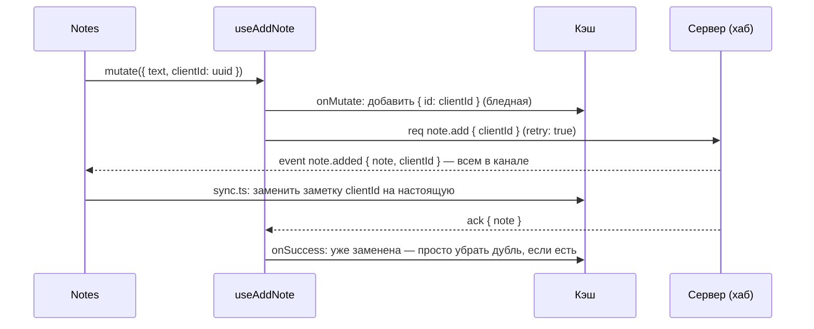

# 5. Заметки к заказу

[src/features/orders/notes.tsx](../../src/features/orders/notes.tsx) и `useAddNote` в
[src/api/mutations.ts](../../src/api/mutations.ts).

## Где это

Страница заказа, блок «Заметки»: маленький чат команды. Написали — заметка появилась сразу,
бледная, с подписью «отправляется…», через мгновение стала обычной. Коллега на той же странице
увидел её у себя.

## Что делает

- Показывает заметку **сразу** (оптимистично), не дожидаясь сервера.
- Отправляет её **по сокету** запросом `note.add` и ждёт подтверждения (`ack`).
- Без связи заметка ждёт в очереди и уходит сама, когда связь вернётся (до 15 секунд).
- Повтор после обрыва не создаёт вторую заметку — по ключу `clientId`.
- Не дошла — заметка исчезает и появляется тост.
- Enter — отправить, Shift+Enter — новая строка; новый текст прокручивает список вниз.
- Роль без права «писать заметки» видит объяснение вместо формы.

## Пропсы

| Проп | Тип | Зачем |
| --- | --- | --- |
| `orderId` | `string` | к какому заказу |
| `notes` | `Note[]` | список из кэша (`orderQuery`) |

## Путь одной заметки



Событие и `ack` могут прийти в любом порядке — обе ветки готовы к этому.

## Код по частям

### Компонент

```tsx
export function Notes({ orderId, notes }) {
  const [text, setText] = useState('')
  const addNote = useAddNote(orderId)
  const canWrite = useCan('orders.note')
  const online = useRealtimeStatus().status === 'online'
  const listRef = useRef<HTMLUListElement>(null)

  useEffect(() => {
    listRef.current?.scrollTo({ top: listRef.current.scrollHeight, behavior: 'smooth' })
  }, [notes.length])
```

- `notes` приходят пропсом из кэша — компонент не хранит заметки у себя. Поэтому заметка коллеги
  (через `sync.ts`) и своя (через мутацию) появляются одинаково.
- Прокрутка вниз — при изменении **количества**, а не на каждый рендер.

```tsx
  const submit = (event: FormEvent) => {
    event.preventDefault()
    const value = text.trim()
    if (!value) return
    addNote.mutate({ text: value, clientId: crypto.randomUUID() })
    setText('')
  }
```

**`clientId` придумывает клиент** — до отправки. По нему сервер узнает повтор, а клиент — свою
заметку в событии `note.added`. Поле очищается сразу: человек может писать следующую.

```tsx
{notes.map((note) => {
  const pending = !note.id.startsWith('n_')
  return (
    <li key={note.id} className={cn('slide-in flex gap-3', pending && 'opacity-60')}>
      …{pending ? 'отправляется…' : formatDateTime(note.at)}
    </li>
  )
})}
```

Как отличить неподтверждённую? У настоящих заметок `id` выдаёт сервер (`n_…`), у временной `id` —
это `clientId` (UUID). Отдельного флага не нужно.

`aria-live="polite"` на списке — скринридер зачитает новую заметку коллеги.

```tsx
onKeyDown={(event) => {
  if (event.key === 'Enter' && !event.shiftKey) submit(event)
}}
```

Как в мессенджерах. `maxLength={500}` — то же ограничение, что в схеме сервера.

```tsx
{canWrite && !online && <p>Нет связи — заметка уйдёт, когда соединение восстановится.</p>}
```

Честно говорим, что происходит: без этой строки бледная заметка без связи выглядела бы
«зависшей».

### Мутация

```ts
mutationFn: ({ text, clientId }) =>
  realtime.request('note.add', { orderId, text, clientId }, { retry: true, timeout: 15_000 }),
```

`useMutation` работает с **любой** функцией, возвращающей Promise, — не только с HTTP. Здесь это
запрос по сокету. `retry: true` разрешён, потому что сервер идемпотентен по `clientId`.

```ts
onMutate: ({ text, clientId }) => {
  const user = auth.session!.user
  const optimistic: Note = { id: clientId, orderId, authorId: user.id, authorName: user.name, hue: user.hue, text, at: new Date().toISOString() }
  queryClient.setQueryData<OrderDetail>(key, (detail) => (detail ? { ...detail, notes: [...detail.notes, optimistic] } : detail))
},
```

Временная заметка с `id = clientId` — по нему её найдут и событие, и ответ.

```ts
onSuccess: ({ note }, { clientId }) => {
  queryClient.setQueryData<OrderDetail>(key, (detail) => detail ? {
    ...detail,
    notes: detail.notes.some((n) => n.id === note.id)
      ? detail.notes.filter((n) => n.id !== clientId)          // событие уже добавило настоящую — убрать временную
      : detail.notes.map((n) => (n.id === clientId ? note : n)), // ack раньше события — заменить здесь
  } : detail)
},

onError: (error, { clientId }) => {
  queryClient.setQueryData<OrderDetail>(key, (detail) =>
    detail ? { ...detail, notes: detail.notes.filter((n) => n.id !== clientId) } : detail)
  // + тост «Заметка не отправлена»
},
```

На сервере ([backend/index.ts](../../src/backend/index.ts)) вторая половина идемпотентности:

```ts
const duplicate = notesByClientId.get(clientId)
if (duplicate) return { note: duplicate }   // повтор — прежний результат, без второй заметки
```

## Что будет, если…

| Сделать | Что сломается |
| --- | --- |
| `clientId` генерирует сервер | повтор после обрыва создаёт вторую заметку; свою заметку в событии не узнать |
| убрать `retry: true` | обрыв сразу после отправки — заметка пропадает с ошибкой, хотя могла сохраниться |
| хранить заметки в `useState` компонента | заметки коллег не появятся, пока не перезагрузишь страницу |
| убрать ветку `some(n => n.id === note.id)` в `onSuccess` | своя заметка видна дважды |

## Проверьте себя

1. Почему заметки идут по сокету, а смена статуса — по HTTP?
2. Как компонент понимает, что заметка ещё не подтверждена?
3. Режим настоящего сервера: остановили сервер, написали заметку, через 20 секунд запустили. Что
   увидит человек?

<details>
<summary>Ответы</summary>

1. Учебная причина — показать запрос-ответ поверх сокета. Практическая — заметки и так живут в
   канале заказа как чат: ответ и рассылка коллегам — одним механизмом. Статусу нужны коды HTTP
   (409 при конфликте версий) и обычный REST.
2. Её `id` не начинается с `n_` — это `clientId`, а не id от сервера.
3. Таймаут запроса — 15 с: заметка исчезнет, появится тост «Заметка не отправлена». Сервер её не
   получил, так что дубля не будет.
</details>
