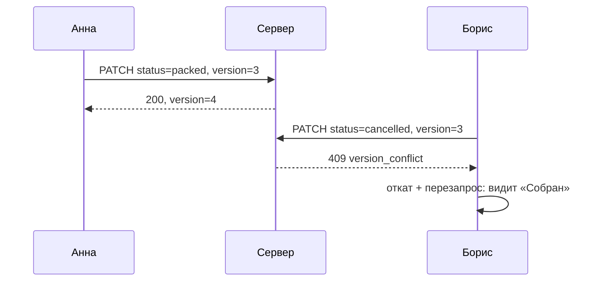

# 7. Смена статуса заказа

`useOrderStatus` в [src/api/mutations.ts](../../src/api/mutations.ts) и кнопки на
[странице заказа](../../src/routes/_app/orders/$orderId.tsx).

## Где это

Страница заказа: кнопки «Оплачен», «Собран», «Отправлен»… и «Отменить» с подтверждением.
Нажали — бейдж статуса поменялся мгновенно, через долю секунды — тост «№1042: собран».

## Что делает

- Показывает только допустимые переходы (`STATUS_FLOW`): из «Новый» нельзя сразу в «Доставлен».
- Меняет статус в интерфейсе **сразу** (оптимистично), запрос идёт следом.
- Сервер отказал — возвращает как было и объясняет почему.
- Отправляет **версию** заказа: если его успел изменить кто-то другой, сервер ответит 409, и
  интерфейс покажет свежие данные.
- Необратимое (отмена) — только через диалог подтверждения.
- Чужие изменения этого заказа — тостом «Анна: собран».

## Код по частям

### Кнопки

```tsx
const next = STATUS_FLOW[order.status]          // например, ['paid', 'cancelled']

{canUpdate && next.length > 0 && next.map((target) =>
  target === 'cancelled'
    ? <AlertDialog>…<AlertDialogAction onClick={() => status.mutate({ status: target, version: order.version })}>…
    : <Button disabled={status.isPending} onClick={() => status.mutate({ status: target, version: order.version })}>
        {status.isPending ? <Loader2Icon className="animate-spin" /> : <CheckIcon />}
        {ORDER_STATUS_ACTIONS[target]}
      </Button>
)}
```

- `STATUS_FLOW` лежит в `shared/schemas.ts` — **тот же** список проверяет сервер. Кнопок
  недопустимых переходов нет, а если отправить запрос в обход — сервер откажет.
- `canUpdate` — у наблюдателя кнопок нет (права тоже общие для обеих сторон).
- `disabled={status.isPending}` — двойной клик не отправит два запроса.
- Подпись кнопки — действие («Отметить оплаченным»), а не «ОК».

### Мутация: четыре момента

```ts
mutationFn: (input: { status: OrderStatus; version: number }) =>
  api<Order>(`/orders/${orderId}`, { method: 'PATCH', body: input }),
```

**1. `onMutate` — до запроса:**

```ts
onMutate: async ({ status }) => {
  await queryClient.cancelQueries({ queryKey: key })
  const previous = queryClient.getQueryData<OrderDetail>(key)
  if (previous) queryClient.setQueryData<OrderDetail>(key, { ...previous, order: { ...previous.order, status } })
  return { previous }
},
```

- `cancelQueries` — если прямо сейчас идёт запрос этого заказа, его ответ (со **старым**
  статусом) пришёл бы позже и затёр бы наше обновление. Отменяем.
- Запоминаем `previous` — вернём его, если сервер откажет.
- **Версию не трогаем.** Её увеличит сервер. Если поднять её здесь, событие из сокета о нашей
  же правке (оно может прийти раньше ответа HTTP) было бы отброшено как «не новее».
- Что вернули из `onMutate` — придёт третьим аргументом (`context`) в `onError`.

**2. `onError` — сервер отказал:**

```ts
onError: (error, _input, context) => {
  if (context?.previous) queryClient.setQueryData(key, context.previous)
  toast.error('Статус не изменён', { description: error.message })
  if (error instanceof ApiError && error.status === 409) void queryClient.invalidateQueries({ queryKey: key })
},
```

Откат и объяснение. **409** — заказ успел изменить кто-то другой (версии разошлись). Тогда
просто вернуть «как было» мало — «как было» уже устарело. Перезапрашиваем свежий заказ.

**3. `onSuccess` — сервер принял:**

```ts
onSuccess: (order) => {
  queryClient.setQueryData<OrderDetail>(key, (detail) => (detail && detail.order.version <= order.version ? { ...detail, order } : detail))
  queryClient.setQueriesData<Page<OrderRow>>({ queryKey: keys.orderLists }, (page) => page ? { …строка с новым статусом… } : page)
  toast.success(`${order.number}: ${ORDER_STATUS_LABELS[order.status].toLowerCase()}`)
},
```

Кладём **ответ сервера** (с новой версией и историей) — но только если в кэше не что-то ещё
новее (`version <=`). Списки правим там же, чтобы при возврате к таблице статус был верный без
перезапроса.

## Как сервер ловит конфликт

```ts
// backend/api.ts
if (patch.version !== order.version) throw new HttpError(409, 'version_conflict', 'Заказ уже изменил кто-то другой. Данные обновлены.')
```

Это **оптимистичная блокировка**: никто ничего не запирает, но каждый говорит «я менял версию
3». Если она уже 4 — значит, вы смотрели на устаревшие данные, и ваше изменение может быть
ошибкой (например, вы «отправили» заказ, который коллега уже отменил).



## Что будет, если…

| Убрать | Что сломается |
| --- | --- |
| `cancelQueries` | ответ запроса, ушедшего до клика, возвращает старый статус поверх нового |
| `return { previous }` | при ошибке нечем откатить — интерфейс врёт |
| `version` в теле запроса | последний нажавший молча перезаписывает чужое изменение |
| проверку `version <=` в `onSuccess` | более новое событие из сокета затрётся ответом |

## Проверьте себя

1. Экран «Соединение» → «Сервер отвечает ошибкой», затем смените статус. Что увидите?
2. Почему версия не увеличивается в `onMutate`?

<details>
<summary>Ответы</summary>

1. Статус сменится мгновенно и тут же вернётся обратно; тост «Статус не изменён» с текстом
   ошибки.
2. Версию двигает только сервер. Поднятая на клиенте версия совпала бы с версией события о нашей
   же правке, и `sync.ts` отбросил бы его как не новее — а в событии свежие `updatedAt` и
   история.
</details>
